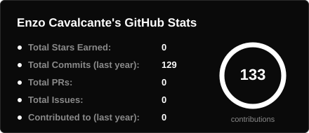
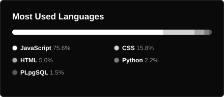
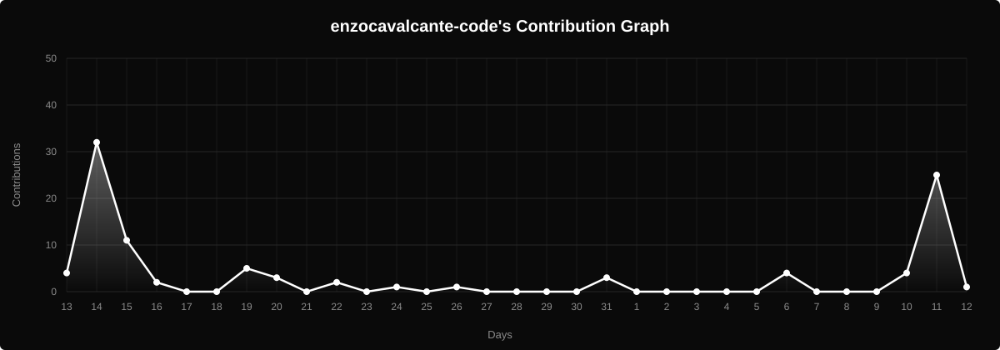

  

<code>&gt;_ ­Full Stack Development Student</code>

  
  
  

Construindo sistemas  confiáveis, com arquitetura limpa e soluções escaláveis.

 

### 🚀 Sobre mim

<picture>
  <source media="(prefers-color-scheme: light)" srcset="assets/about-light.png">
  
</picture>

**Enzo** Aqui, sou um estudante do ultimo ano no curso técnico em desenvolvimento de sistemas.

////

 

### 💻 Tecnologias

  &nbsp;
  <picture>
    <source media="(prefers-color-scheme: light)" srcset="https://cdn.simpleicons.org/github/181717">
    
  </picture>&nbsp;
  &nbsp;
  &nbsp;
  &nbsp;
  &nbsp;
  &nbsp;
  &nbsp;
  &nbsp;
  &nbsp;
  

 

### 📊 Status

  

  
  

### 📈 Gráfico de atividade

  <picture>
    <source media="(prefers-color-scheme: light)" srcset="assets/activity-light.svg">
    
  </picture>

